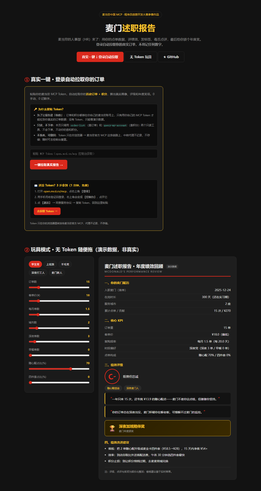

# 麦门述职报告 · mcd-performance-review

> **麦当劳的人事部（HR）来了**：它用你的真实订单，给你出一份年度述职——
> 评绩效、发标签、毒舌点评，最后**给你颁一个年度奖**。
>
> 示例：「客单价 ¥22.86，综合评级 **C-**，荣获 **年度最抠门奖** 🏆」

麦当劳程序员创意开发大赛参赛作品 · 非麦当劳官方产品。

  

---

## 这是什么

把麦当劳订单塞进「职场述职报告」这个全民梗里，让它给你**算账 + 整活**两不误：

- **整活（想转发）**：绩效评级、人设标签、毒舌点评、年度颁奖
- **算账（想照做）**：省钱、效率、积分止损三条可执行建议

| 它能回答 | 能力 |
|---|---|
| 我这一年点得怎么样？ | 麦门履历：首单、在岗时长、覆盖几座城、贡献多少 |
| 我是哪种麦门人？ | 人设标签：随心配信徒 / 四件套贵族 / 深夜麦门人 / 漂泊麦门客 / 早餐打卡党 |
| 我算几级员工？ | 绩效评级：S / A / B / C+ / C- / D |
| 老板怎么看我的？ | 毒舌点评：基于真实数据生成的自嘲金句 |
| 我该领什么奖？ | **年度颁奖**：年度最抠门奖 / 深夜加班陪伴奖 / 全国巡回吃堡奖 … |
| 下一年怎么点更省？ | 省钱参谋：省钱 / 效率 / 积分止损 |

🎮 **在线预览（无需 Token）**：<https://2843453580-star.github.io/mcd-performance-review/> —— 拖滑块或点预设角色，实时生成你的述职报告。



---

## 年度颁奖（本作品最"出片"的地方）

除了告诉你"省了多少钱"，我们还会给你**颁一个专属奖**。奖不是白发的，全看你的数据：

| 你的数据 | 会领到什么奖 |
|---|---|
| 随心配占比 ≥ 40% | **年度最抠门奖** |
| 深夜订单 ≥ 2 单 | **深夜加班陪伴奖** |
| 跨 ≥ 3 座城市 | **全国巡回吃堡奖** |
| 四件套占比 ≥ 30% | **麦门 VIP 金卡奖** |
| 早餐订单多 | **最卷打工人奖** |
| 评级 S / A | **麦门终身成就奖** |

"我得了麦门年度最抠门奖"——这句话本身就值得截图发朋友圈。

---

## 怎么做到的（麦门 HR 的三板斧）

1. **查你的底**：`order-list` 拉历史订单（金额、门店、时间、城市），`query-my-account` 拉积分；
2. **算你的账**：本地聚合客单价、复购频率、时段、城市轨迹；
3. **给你评级、发奖**：规则引擎生成人设标签、绩效评级、毒舌点评、年度奖项；
4. **顺带省钱**：`query-meals` 读门店菜单，给出可执行的省钱 / 效率 / 止损建议。

全程零依赖，金额与画像来自 MCP 实时数据，评级与点评是确定性的规则（不靠大模型胡编）。

---

## 安装 WorkBuddy 技能（推荐，对话里直接用）

1. **配好麦当劳 MCP**：WorkBuddy 左侧【专家·技能·连接器】→【连接器】→【自定义连接器】→【配置 MCP】，填入 [`mcp-config.example.json`](mcp-config.example.json)，把 `${MCD_MCP_TOKEN}` 换成你的真实 Token，保存后【启用】。
2. **安装技能**：把仓库里的 `skills/mcd-performance-review/` 整个文件夹，复制到 WorkBuddy 的技能目录：
   - Windows：`%USERPROFILE%\.workbuddy\skills\`
   - macOS / Linux：`~/.workbuddy/skills/`
3. **使用**：在对话框里说「给我出份麦门述职报告」，它就会自动拉你的订单、算评级、发奖、给省钱建议。

> Token 申请：https://open.mcd.cn/mcp（手机号登录 → 控制台 → 激活）。

---

## 命令行版（可选）

```bash
# 1. 申请麦当劳 MCP Token：https://open.mcd.cn/mcp（手机号登录 → 控制台 → 激活）
# 2. 配置 Token
cp .env.example .env   # 填入 MCD_MCP_TOKEN（.env 已 gitignore，不会提交）
# 3. 运行（零依赖，仅需 Node >= 18）
npm run demo      # 无需 Token，先看一份演示述职报告
npm run review    # 用你的真实订单，生成你的述职报告 + 年度奖项
npm run probe     # 列出麦当劳 MCP 的全部工具
```

---

## 使用示例

**学生党**：「一年只来 10 次，还专挑 ¥13.9 的随心配点」→ 年度最抠门奖。

**上班族**：午餐党 28/63 单、四件套贵族 → 麦门 VIP 金卡奖。

**漂泊打工人**：4 座城市点过单 → 全国巡回吃堡奖，「麦门以为你在全国巡回吃汉堡」。

---

## 哪些是真的，哪些是整活

| 项目 | 真 / 整活 | 说明 |
|---|---|---|
| 客单价 / 频率 / 门店 / 城市 | ✅ 真 | `order-list` / `query-my-account` 实时返回 |
| 省钱建议（麦金卡价差） | ✅ 真 | 实测：体验卡 15 天 ¥9.9、四件套 ¥58.5→¥28 |
| 积分（可用 / 已过期） | ✅ 真 | `query-my-account` 返回 |
| 绩效评级 / 人设标签 | 🎭 整活 | 规则打分，仅供娱乐 |
| 毒舌点评 / 年度奖项 | 🎭 整活 | 模板 + 真实数据拼装，自嘲向 |

---

## 开发手记

用真实 MCP 联调时踩到的一些点（2026-10）：

- 官方文档写 34 个工具，实测是 **35 个**（多出 `query-promotions`、`query-survey-coupon`）；
- 麦金卡是「随单购」：体验卡（15 天）¥9.9，解锁四件套价 `¥58.5 → ¥28`，单套省 ¥30.5；
- 早餐卡优惠只在早餐时段出现在门店菜单里，下午查返回 0 条；
- `order-list` 无参数直接返回历史订单，但只回最近约 10 单；
- `query-my-account` 一次给全可用/累计/已过期/本月过期/下月过期，够做止损提醒。

---

## 目标用户

- **学生 / 上班族**：想要一份好玩、能转发、又能真省钱的麦门年度总结；
- **羊毛党**：想知道自己一年白扔了多少积分、下次怎么点更省；
- **麦门梗爱好者**：就想看看自己的麦门人设和年度奖项。

---

## 目录结构

```
mcd-performance-review/
├── README.md                 # 本文件
├── CONTEST_DECLARATION.md    # 参赛声明（官方原文，勿改动）
├── MCP_INTEGRATION.md        # MCP 集成说明
├── mcp-config.example.json   # 脱敏 MCP 配置（仅环境变量占位符）
├── .env.example              # 本地环境变量模板
├── package.json
├── skills/
│   └── mcd-performance-review/
│       └── SKILL.md          # ← WorkBuddy 技能（核心交付物）
├── docs/
│   └── index.html            # 在线玩具预览（零依赖静态页）
├── images/
│   └── site.png              # 网页界面截图
├── cloud/
│   ├── fc-proxy.js           # 国内云函数中转（可选）
│   └── README.md             # 云函数部署说明
└── src/
    ├── mcp.mjs               # 极简 Streamable HTTP MCP 客户端
    ├── probe.mjs             # 工具清单探针
    ├── review.mjs            # 述职报告主流程（评级 + 颁奖 + 省钱参谋）
    └── demo.mjs              # 无 Token 演示模式
```

---

## 搜索关键词

<details>
<summary>🔍 想用哪些词能搜到本项目？（点开查看）</summary>

**中文**：麦当劳 · 麦门 · 述职报告 · 绩效评级 · 麦门人设 · 毒舌点评 · 年度颁奖 · 省钱 · 积分 · 麦当劳程序员创意开发大赛 · MCP · AI 智能体

**English**: McDonald's / McDonalds China / MCD · MCP · mcd-mcp · performance review · annual award · agent skill · money saving

推荐搜索词：`麦门` · `述职报告` · `麦当劳 MCP` · `mcd mcp` · `mcdonalds skill`
</details>

---

## 参赛说明

本项目为麦当劳程序员创意开发大赛参赛作品，由参赛者独立开发，**非麦当劳官方产品**。
详见 `CONTEST_DECLARATION.md` 与 `MCP_INTEGRATION.md`。

## 免责声明

项目输出仅供参考，不构成消费或理财建议；评级、点评与奖项为娱乐化内容；
餐品价格、卡权益、积分规则与供应状态以麦当劳官方渠道的实时结果为准。

## 许可

MIT License（见 [LICENSE](LICENSE)）。
