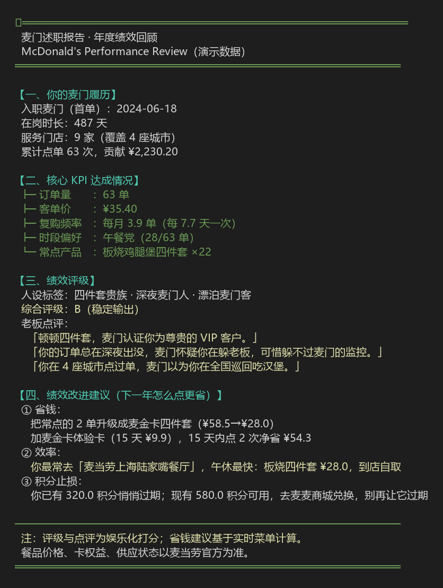
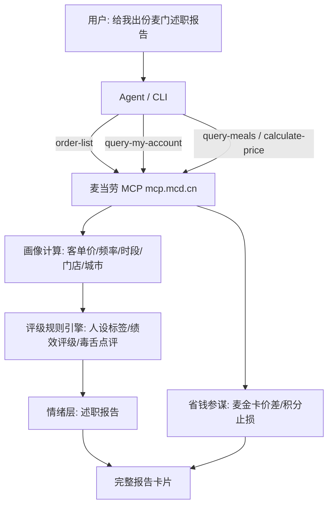

# 麦门述职报告 · mcd-performance-review

> **麦当劳给你出年度述职**：用你的真实订单，生成一份「麦门绩效回顾」——
> 你这一年点得怎么样、绩效评级几等、老板怎么点评你，以及下一年怎么点更省。
>
> 示例：「客单价 ¥22.86，综合评级 **C-**，**抠搜但忠诚**。」

麦当劳程序员创意开发大赛参赛作品 · 非麦当劳官方产品。

  

---

## 一句话介绍

**用户说「给我出份麦门述职报告」，它拉取你的历史订单、积分、门店菜单，
用规则引擎算出你的麦门 KPI、人设标签和绩效评级，再附一份毒舌老板点评 + 省钱参谋。**

它不止会「算账」，还同时给你 **情绪** 和 **实用** 两层：

| 问题 | 能力 |
|---|---|
| 我这一年点得怎么样？ | **麦门履历**：首单时间、在岗时长、覆盖几座城、贡献多少 |
| 我是哪种麦门人？ | **人设标签**：随心配信徒 / 四件套贵族 / 深夜麦门人 / 漂泊麦门客 / 早餐打卡党 |
| 我算几级员工？ | **绩效评级**：S / A / B / C+ / C- / D，附一句毒舌评语 |
| 老板怎么点评我？ | **毒舌点评**：基于真实数据生成的自嘲式金句 |
| 下一年怎么点更省？ | **省钱参谋**：省钱 / 效率 / 积分止损三条可执行建议 |

🎮 **快速体验（无需 Token）**：`npm run demo` 直接打印一份演示述职报告。
真实数据版 `npm run review` 需要你自己的麦当劳 MCP Token。



---

## 它解决什么问题

市面上的「省钱助手」只会冷冰冰地报价格；「年度报告」只给你一堆数字。
**本作品把算账和情绪绑在一起**——用职场「述职报告」这个全民梗做容器：

- **情绪层**（让人想转发）：绩效评级 + 人设标签 + 毒舌点评，戳中「打工人」的共鸣；
- **实用层**（让人想收藏）：省钱参谋给出带具体数字的可执行建议。

核心洞察：**取数交给 MCP，算术交给代码，表达交给 Agent。**

| 角色 | 职责 |
|---|---|
| 麦当劳 MCP | 历史订单、积分、门店菜单、价格 |
| `src/review.mjs` | 画像计算 + 评级规则引擎 + 建议生成 |
| AI Agent / 命令行 | 理解需求、渲染报告、讲解结论 |

---

## 架构



---

## 快速开始

### 1. 申请麦当劳 MCP Token

前往 https://open.mcd.cn/mcp ，手机号登录 → 控制台 → 激活 → 复制 Token。

### 2. 配置 Token

```bash
# 复制 .env.example 为 .env 并填入（.env 已加入 .gitignore，不会提交）
cp .env.example .env
# 编辑 .env：MCD_MCP_TOKEN=你的token
```

### 3. 运行（零依赖，仅需 Node >= 18）

```bash
npm run demo      # 无需 Token，先看一份演示述职报告
npm run review    # 用你的真实订单，生成你的麦门述职报告
npm run probe     # 列出麦当劳 MCP 的全部工具与参数
```

---

## 使用示例

**示例 1 · 学生党**
> 首单 2025-09，在岗 180 天（还在实习期），随心配信徒 ×4，
> 评级 C-「一年只来 10 次，还专挑 ¥13.9 的随心配点」。

**示例 2 · 上班族**
> 午餐党 28/63 单，四件套贵族，评级 B「顿顿四件套，麦门认证你为 VIP」。

**示例 3 · 漂泊打工人**
> 4 座城市点过单 → 人设「漂泊麦门客」，「麦门以为你在全国巡回吃汉堡」。

**示例 4 · 省钱参谋**
> 把 2 单随心配升级成麦金卡四件套（¥58.5→¥28），15 天内净省 ¥54+。

---

## 真实性对照表

| 项目 | 性质 | 说明 |
|---|---|---|
| 画像数字（客单价/频率/门店/城市） | ✅ 真实 | 由 `order-list` / `query-my-account` 实时返回，非人工编排 |
| 绩效评级 / 人设标签 | 🟡 娱乐化 | 规则引擎打分，仅供娱乐，非官方 |
| 毒舌点评 | 🟡 娱乐化 | 模板 + 真实数据拼装，自嘲向 |
| 省钱建议（麦金卡价差） | ✅ 真实 | `query-meals` 实测：体验卡 15 天 ¥9.9、四件套 `¥58.5→¥28` |
| 积分数据 | ✅ 真实 | `query-my-account` 返回的可用/已过期/临期积分 |
| 下单能力 | — | 本作品不涉及下单，仅做回顾与建议 |

---

## 实测发现

开发过程中用真实 MCP 联调得到的观察（2026-10，个人账号实测）：

- **实际是 35 个工具**：官方文档列 34 个，实测多出 `query-promotions`、`query-survey-coupon`。
- **麦金卡是「随单购」**：麦金卡体验卡（15 天）随单购 **¥9.9**，解锁四件套专属价（板烧四件套 `¥58.5 → ¥28`，单套省 ¥30.5）；扣卡费后 15 天内点 2 次净省约 ¥54。
- **早餐卡有时段限制**：早餐卡优惠品项只在早餐时段出现在门店菜单里，下午查询返回 0 条。
- **`order-list` 无参数**：直接返回历史订单（含商品明细、金额、门店、时间），但只回最近约 10 单。
- **积分字段很全**：`query-my-account` 一次返回可用/累计/已过期/本月过期/下月过期，够做「止损提醒」。

---

## 技术亮点

- **零依赖**：Node 18+ 自带 `fetch`，纯标准库，无需 `npm install`。
- **单文件 MCP 客户端**：`src/mcp.mjs` 支持 Streamable HTTP 的 JSON 与 SSE 两种响应，自动维护会话 ID。
- **自动读 `.env`**：无需手动设环境变量，开箱即用。
- **确定性规则引擎**：评级/标签/点评全部可复现，不靠大模型胡编。
- **诚实标注**：真实性对照表把「真实数据」和「娱乐化打分」分得清清楚楚。

---

## 目标用户

- **学生 / 上班族**：想要一份好玩、能转发、又能真省钱的「麦门年度总结」。
- **羊毛党**：想知道自己一年到底白扔了多少积分、下次怎么点更省。
- **麦门梗爱好者**：就想看看自己的「麦门人设」和「老板点评」。

---

## 目录结构

```
mcd-performance-review/
├── README.md                 # 本文件
├── CONTEST_DECLARATION.md    # 参赛声明（官方原文，勿改动）
├── MCP_INTEGRATION.md        # MCP 集成说明
├── mcp-config.example.json   # 脱敏 MCP 配置（仅环境变量占位符）
├── .env.example              # 本地环境变量模板
├── package.json
├── images/
│   └── demo.png              # 述职报告示例截图
└── src/
    ├── mcp.mjs               # 极简 Streamable HTTP MCP 客户端
    ├── probe.mjs             # 工具清单探针
    ├── review.mjs            # 述职报告主流程（情绪 + 实用）
    └── demo.mjs              # 无 Token 演示模式
```

---

## 搜索关键词

<details>
<summary>🔍 想用哪些词能搜到本项目？（点开查看）</summary>

**中文**：麦当劳 · 麦门 · 述职报告 · 绩效评级 · 麦门人设 · 毒舌点评 · 省钱参谋 · 积分止损 · 麦当劳程序员创意开发大赛 · MCP · AI 智能体 · Agent Skill · WorkBuddy

**English**: McDonald's / McDonalds China / MCD · MCP (Model Context Protocol) · mcd-mcp · performance review · annual report · agent skill · AI agent · money saving · Node

推荐搜索词：`麦门` · `述职报告` · `麦当劳 MCP` · `mcd mcp` · `mcdonalds skill`
</details>

---

## 参赛说明

本项目为麦当劳程序员创意开发大赛参赛作品，由参赛者独立开发，**非麦当劳官方产品**。
详见 `CONTEST_DECLARATION.md` 与 `MCP_INTEGRATION.md`。

## 免责声明

项目输出仅供参考，不构成消费或理财建议；评级与点评为娱乐化内容；
餐品价格、卡权益、积分规则与供应状态以麦当劳官方渠道的实时结果为准。

## 许可

MIT License（见 [LICENSE](LICENSE)）。
